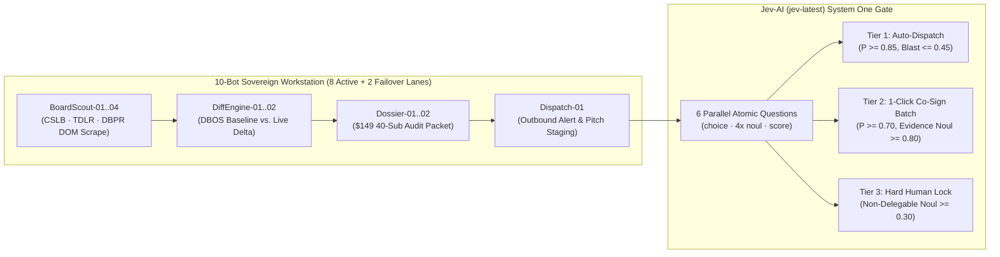

# DecaFleet-OS 🚀

**Sovereign 10-Bot Operational Execution Platform & Jev-AI (`jev-latest`) System One Production Gate**

[](./CHANGELOG.md)
[](./shared/reports/sub_radar/PKT-C1-20261101-001_40_Sub_Liability_Audit.md)
[](./SECURITY.md)
[](./SECURITY.md)

`DecaFleet-OS` is the live production execution platform for a **single-workstation, 10-agent commercial service fleet** (`Hermes Agent + Stagehand + LiteLLM + DBOS`) supervised by 1 human operator. It executes a 4-Stage Sovereign Master Plan across **6 zero-credential / no-login B2B service lines**, starting immediately on Day 1 with **Stage 1: `C1 Sub Radar` (General Contractor Subcontractor License, Surety Bond & Workers'-Comp Compliance Monitoring)**.

> 📋 **Release & Commit Notes:** See [`CHANGELOG.md`](./CHANGELOG.md) for the complete `v1.0.0` release notes and commit history, [`CONTRIBUTING.md`](./CONTRIBUTING.md) for Conventional Commit and pre-commit verification standards, and [`SECURITY.md`](./SECURITY.md) for the Zero-Credential & 3-Tier Jev-AI Constitutional Gate policy.

---

## 1. Core Constitutional Laws & System Architecture



1. **Single-Workstation 10-Bot Fleet Capacity:**
   - 1 human operator supervising 10 concurrent agents across **8 active browser lanes + 2 hot-spare failover lanes** (`38,400 browser-minutes/month` multi-lane capacity; `4,800 browser-minutes/month` single-pointer OS fallback).
   - **Durable State Recovery (`DBOS`):** Every scrape and diff step is checkpointed (`ckpt_*`) so portal timeouts resume from the exact step without re-burning LLM tokens.
2. **Zero-Credential / No-Login Default:**
   - Never stores client passwords, session cookies, or 2FA tokens.
   - Operates strictly on **100% public government sunshine registries** (`CSLB`, `TDLR`, `DBPR`), public ad/funnel URLs, or client-exported CSVs—eliminating third-party account lockouts and IP ban risk.
3. **Jev-AI (`jev-latest`) System One Confidence Gate ([`server.ts`](./server.ts)):**
   - Every outbound artifact is adjudicated in a single parallel pass across **6 atomic probabilistic questions**:
     1. `routing_intent` (`choice`: `auto_dispatch` | `co_sign_batch` | `escalate_human` | `reject_malformed`)
     2. `non_delegable_boundary` (`noul`: tripwire `< 0.30`)
     3. `primary_evidence_verified` (`noul`: minimum `>= 0.80`)
     4. `zero_login_compliant` (`noul`: minimum `>= 0.80`)
     5. `payload_checksum_valid` (`noul`: minimum `>= 0.50`)
     6. `blast_radius` (`score`: `0.00` to `2.00`)
   - **3-Tier Constitutional Routing Policy:**
     - **Tier 1 (`TIER_1_AUTO_DISPATCH`):** Internal staging traces & reversible slot holds (`P >= 0.85`, `blast_radius <= 0.45`, `compositeLiabilityRisk <= 0.15`).
     - **Tier 2 (`TIER_2_CO_SIGN`):** Verified compliance alerts, `$149` 40-Sub Roster Audit Packets, and catalog CSV patches staged for 1-click operator batch release (`P >= 0.70`, `primary_evidence_verified.noul >= 0.80`).
     - **Tier 3 (`TIER_3_HARD_HUMAN_LOCK`):** Any municipal bid signature, 2FA token prompt, or legal dispute (`non_delegable_boundary.noul >= 0.30` or confidence `< 0.60`).

---

## 2. The 4-Stage Revenue Sequence (6 Complete 17-Section Handbooks)

| Stage | Timeline | Active Service Handbooks | Entry Wedge | Core Retainer | Gross Margin | Target MRR Milestone |
| :--- | :--- | :--- | :--- | :--- | :--- | :--- |
| **Stage 1 (Active Now)** | Days 1–30 | **`C1` Sub Radar** (CSLB · TDLR · DBPR License, Bond & WC Monitor) | **\$149** (24h 40-Sub Audit) | **\$399/mo** | **97.0%** | **\$4,300+ MRR** |
| **Stage 2** | Days 31–60 | **`P1` Trade Map Desk** + **`P3` No-Login Funnel & Ad Metadata Desk** | **\$199** / **\$75** Deposit | **\$449/mo** + **\$900/mo** | **96.0%** | **\$15,000+ MRR** |
| **Stage 3** | Days 61–90 | **`P2` Catalog Exception Desk & B2B Signal Ops** (Exported CSV Diffs) | **\$299** (500-SKU Audit) | **\$1,000–\$2,200/mo** | **94.5%** | **\$25,000+ MRR** |
| **Stage 4** | Day 90+ | **`C2` Fleet Collision Lab** + **`C3` Seat Sniper / Municipal GovDesk** | **\$499** (8-Lane QA Audit) | **\$1,800/mo** + **\$400–\$1,400/mo** | **95.8%** | **\$32,500+ MRR** |

---

## 3. Stage 1 (`C1: Sub Radar`) — Day 1 Live Execution & Deliverables

`Sub Radar` protects mid-market General Contractors (\$3M–\$30M annual volume) from catastrophic commercial umbrella insurance invalidation and statutory Stop-Work Orders when any of the 40 specialty subcontractors on their active job sites suffers a mid-project license suspension, surety bond cancellation, or workers'-comp expiration.

### Live Day 1 Pipeline (`PKT-C1-20261101-001`)
- **Target General Contractor:** Sierra Pacific Commercial Builders Inc. (`40 Active Subcontractors` across Sacramento CA, Brickell FL, Dallas TX, and Austin TX job sites).
- **State Registries Polled:** `16 CSLB (CA)` · `12 TDLR (TX)` · `12 DBPR (FL)` (`100% Zero-Login Public Sunshine Portals`).
- **Forensic Audit Outcome:**
  - **2 Critical Stop-Work Breaches (`RED`):**
    - `SUB-01` **Sierra Structural Concrete LLC** (`CSLB #CA-1049281`): \$25k Surety Bond (`#SUR-88412-CA`) lapsed 48h ago $\rightarrow$ automatic license suspension under `CA Bus. & Prof. Code § 7071.6` (**\$420,000** exposure).
    - `SUB-04` **Golden Gate Demolition & Abatement Corp** (`CSLB #CA-9184420`): Workers'-Comp policy (`#CYP-WC-338192`) cancelled 48h ago $\rightarrow$ automatic license suspension under `CA Bus. & Prof. Code § 7125.2` (**\$550,000** exposure).
  - **2 High-Liability Expirations (`ORANGE`):**
    - `SUB-02` **LoneStar Commercial HVAC & Mechanical** (`TDLR #TACLA88392C`): Texas Mutual Workers'-Comp policy (`#TMI-0048291-25`) expired yesterday ahead of 6-man chiller rigging (**\$285,000** exposure).
    - `SUB-05` **Gulf Coast High-Voltage Electrical LLC** (`TDLR #TECL34918`): Master Electrical Contractor license transitioned `ACTIVE -> EXPIRED` overnight (**\$190,000** exposure).
  - **2 Compliance Warnings (`AMBER`):**
    - `SUB-03` **Biscayne Glazing & Curtainwall Inc.** (`DBPR #SCC131152409`): Expired FL DFS Officer Workers'-Comp Exemption under `FL Stat. § 440.107(7)(a)` (**\$165,000** exposure).
    - `SUB-06` **Sunbelt Commercial Roofing & Waterproofing** (`DBPR #CCC1330891`): Lapsed \$50k surety bond (`#OR-FL-66201`) under `FL Admin. Code R. 61G4-15.006` (**\$210,000** exposure).
  - **34 Verified Compliant Subcontractors (`GREEN`):** Full bond carrier, WC carrier, expiration date, and DBOS step checkpoint verification recorded.
  - **Total Uninsured Umbrella Exposure Prevented:** **\$1,820,000 USD**.

### Generated Physical Artifacts
- [`shared/reports/sub_radar/PKT-C1-20261101-001_40_Sub_Liability_Audit.md`](./shared/reports/sub_radar/PKT-C1-20261101-001_40_Sub_Liability_Audit.md) — Client-ready **\$149 40-Subcontractor Forensic Liability Audit Packet** & Cold GC Outreach Tear-Sheet.
- [`shared/data/compliance_breaches.json`](./shared/data/compliance_breaches.json) — `DiffEngine-01..02` structured breach delta output with Jev-AI Tier-2 Co-Sign verdicts.
- [`shared/data/registry_raw.json`](./shared/data/registry_raw.json) — `BoardScout-01..04` 40-subcontractor multi-state DOM snapshot.

---

## 4. Repository Structure & Key Entrypoints

```text
DecaFleet-OS/
├── server.ts                                      # Express + Vite server, Jev-AI System One Gate & Sub Radar API
├── CHANGELOG.md                                   # Semantic release & commit notes (v0.2.0 -> v1.0.0)
├── CONTRIBUTING.md                                # Conventional Commits & pre-commit verification guide
├── SECURITY.md                                    # Zero-Credential mandate & 3-Tier Jev-AI safety policy
├── .env.example                                   # Template for TYPESAFE_API_KEY & runtime environment vars
├── scripts/
│   ├── run_sub_radar_day1_audit.ts                # Stage 1 Day 1 40-Sub Registry Scraper, Diff & Packet Runner
│   └── run_master_plan_jev_audit.ts               # 4-Stage Master Plan Jev-AI Constitutional Audit Runner
├── shared/
│   ├── data/
│   │   ├── registry_raw.json                      # BoardScout-01..04 40-sub public registry snapshot
│   │   └── compliance_breaches.json               # DiffEngine-01..02 flagged statutory compliance breaches
│   └── reports/sub_radar/
│       └── PKT-C1-20261101-001_40_Sub_Liability_Audit.md  # Deliverable $149 40-Sub Liability Audit Packet
└── src/
    ├── App.tsx                                    # Sovereign Execution Command Center root view router
    ├── components/
    │   ├── Header.tsx                             # Top navigation bar, fleet status & telemetry badges
    │   ├── SubRadarLaunchpadView.tsx              # Stage 1 Launchpad UI, Live 40-Sub Diff Table & Packet Viewer
    │   ├── FleetConsoleView.tsx                   # 10-Bot Runtime Telemetry & Lane Allocation Console
    │   ├── BotHealthWidget.tsx                    # Stagehand Self-Healing & DBOS Step Checkpoint Monitor
    │   ├── ApprovalGateView.tsx                   # Jev-AI (jev-latest) 3-Tier Constitutional Gate Inbox
    │   ├── HandbookDetailView.tsx                 # Interactive 17-Section Operator Handbook Viewer
    │   ├── PortfolioRoadmapView.tsx               # 90-Day 4-Stage Sovereign Master Plan & Sequencer
    │   ├── EconomicsModelerView.tsx               # Deterministic Unit Economics & Capacity Simulator
    │   └── AntigravityExportModal.tsx             # Operator Handbook & Artifact Export Modal
    ├── data/
    │   ├── subRadarRoster.ts                      # 40-Subcontractor CSLB/TDLR/DBPR Roster & Audit Markdown Builder
    │   └── handbooks.ts                           # 6 Complete 17-Section Operator Handbooks (C1, P1, P2, P3, C2, C3)
    ├── types/
    │   └── index.ts                               # Strictly typed interfaces for bots, handbooks, and Jev-AI gate
    └── utils/
        ├── calculator.ts                          # Unit Economics, Capacity Math & Fleet Health Engine
        └── calculator.test.ts                     # Deterministic Unit Tests for Fleet & Financial Math
```

---

## 5. Quick Start, Environment Setup & CLI Commands

### 1. Environment Configuration
Copy [`.env.example`](./.env.example) to `.env` (never committed to Git):
```bash
cp .env.example .env
```

| Variable | Default / Example | Purpose |
| :--- | :--- | :--- |
| `TYPESAFE_API_KEY` | `""` | Primary API key for TypeSafe AI System One (`JEV_AI_API_KEY` alias also supported). |
| `TYPESAFE_API_URL` | `https://api.typesafe.ai/v1/systemone` | Jev-AI System One probabilistic evaluation endpoint. |
| `TYPESAFE_MODEL` | `jev-latest` | System One model identifier used for the 6-question gate. |
| `GEMINI_API_KEY` | `""` | Optional secondary fallback API key. |

*(Note: When `TYPESAFE_API_KEY` is omitted locally, `server.ts` automatically falls back to its deterministic System One mathematical evaluator so local development and CI tests run offline.)*

### 2. Installation & Local Development
```bash
npm install
npm run dev
```
Open `http://localhost:3000` to access the **DecaFleet-OS Sovereign Execution Command Center**.

### 3. CLI Operational & Verification Scripts
```bash
# Execute Day 1 Stage 1 (Sub Radar C1) 40-Subcontractor Scrape, Diff & $149 Audit Packet Generation
npm run audit:sub-radar

# Run the 4-Stage Master Plan Jev-AI (jev-latest) System One Constitutional Audit
npm run audit:master-plan

# Run Unit Economics & Fleet Capacity Math Test Suite
npm test

# Run TypeScript Strict Static Typecheck
npm run lint
```

### 4. Express + Jev-AI Backend Endpoints ([`server.ts`](./server.ts))
| Method | Endpoint | Description |
| :--- | :--- | :--- |
| `POST` | `/api/sub-radar/ingest-diff` | Runs `BoardScout-01..04` + `DiffEngine-01..02` across the 40-sub roster, flags state board deltas, updates bot telemetry, and adjudicates all alerts + the \$149 Audit Packet via Jev-AI (`jev-latest`). |
| `GET` | `/api/sub-radar/audit-packet` | Returns the complete 40-Subcontractor Liability Audit Packet metadata, breach diffs, and Markdown report. |
| `POST` | `/api/jev-ai/evaluate` | Evaluates a single bot artifact across the 6 atomic System One questions (`choice`, `noul`, `score`). |
| `POST` | `/api/jev-ai/evaluate-batch` | Batch-evaluates multiple outbound artifacts through the 3-Tier Constitutional Gate. |
| `GET` | `/api/bot-health` | Returns real-time health, DBOS checkpoints, CPU/RAM, and Stagehand self-healing telemetry for `bot-01`..`bot-10`. |
| `POST` | `/api/bot-health/action` | Triggers Stagehand selector self-healing (`stagehand_heal`, `heal_all`), drift simulation, or session recycling. |
