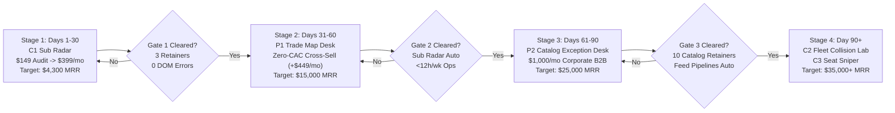
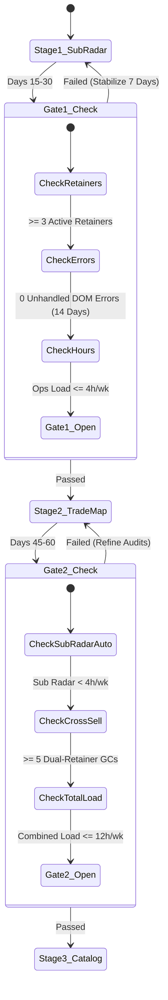
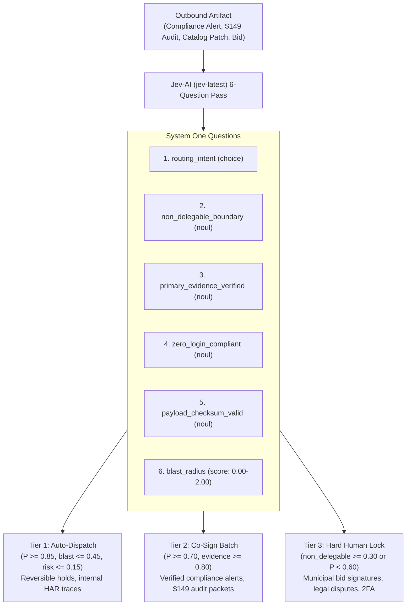

# DecaFleet-OS: Sovereign Execution Roadmap & Phased Timeline (2026–2027)

> **Platform:** DecaFleet-OS v1.0.0  
> **Architecture:** 10-Bot Autonomous Swarm (`Hermes Agent + Stagehand + LiteLLM + DBOS`) supervised by 1 Human Operator  
> **Constitutional Gate:** TypeSafe AI Jev (`jev-latest`) System One Probabilistic Adjudicator  
> **Capacity:** 8 Active Browser Lanes + 2 Failover Lanes (`38,400 browser-min/month`)  
> **Operator Ceiling:** Maximum 20 Hours / Week  

---

## 1. Executive Strategy & Revenue Trajectory

DecaFleet-OS is structured as a sequential, gate-enforced multi-stage rollout designed to maximize early cash flow, eliminate third-party credential dependencies, and scale sustainably from **\$0 to \$35,000+ MRR** within the constraints of a single-workstation, solo-operator footprint.

### Revenue & Capacity Summary Across Stages

| Phase | Milestone Window | Active Service Handbooks | Wedge Offer | Core Monthly Retainer | Gross Margin | Target Client Roster | Target MRR |
| :--- | :--- | :--- | :--- | :--- | :--- | :--- | :--- |
| **Stage 1** | **Days 1–30** | `C1` Sub Radar | **\$149** (40-Sub Audit) | **\$399/mo** | **97.0%** | 10 GCs + 8 Audits/mo | **\$4,300+** |
| **Stage 2** | **Days 31–60** | `P1` Trade Map Desk + `P3` Funnel Desk | **\$199** / **\$75** Audit | **\$449/mo** + **\$900/mo** | **96.0%** | 25 Sub Radar + 12 Trade Map | **\$15,000+** |
| **Stage 4** | **Day 90+** | `C2` Fleet Collision Lab + `C3` Seat Sniper | **\$499** (Collision Audit) | **\$1,800/mo** + **\$400/mo** | **95.8%** | Multi-Vertical Full Portfolio | **\$32,500–\$40,000+** |

---

## 2. Velocity Models: Blitz vs. Stress Test vs. Annual Plan

DecaFleet-OS provides three velocity models in its operational sequencer:

```mermaid
flowchart TD
    subgraph M1["60-Day Trigger Blitz (Recommended Production)"]
        B1["Day 1-30: Stage 1 Stabilize & Gate 1"] --> B2["Day 31-60: Stage 2 Cross-Sell & Gate 2"] --> B3["Day 61-90: Stage 3 Corporate Expansion"]
    end
    subgraph M2["12-Day Stress Test (Benchmark Failure Mode Simulation)"]
        F1["Day 1-3: C1 Launch"] --> F2["Day 4-6: P1 + P2 Jump"] --> F3["Day 7-12: C2 Multi-Vertical Load Spike (36.5h/wk -> Operator Burnout)"]
    end
    subgraph M3["12-Month Enterprise Timeline (Conservative Corporate)"]
        L1["Q1: C1 Foundation ($4k MRR)"] --> L2["Q2: P1 Trade Retainers ($12k MRR)"] --> L3["Q3: P2 Catalog Scale ($22k MRR)"] --> L4["Q4: Enterprise Collision Suites ($35k+ MRR)"]
    end
```

### Velocity Comparison Matrix

| Dimension | 60-Day Trigger Blitz (Recommended) | 12-Day Stress Test Mode | Legacy 12-Month View |
| :--- | :--- | :--- | :--- |
| **Expansion Trigger** | Strict Metric Gates (Cash + 0 DOM errors) | Calendar Force (Days 1, 4, 7, 10) | Quarterly Corporate Reviews |
| **Operator Workload** | 8.5 to 16.0 hours / week | 36.5 hours / week (**Tripwire Breach**) | 4.0 to 10.0 hours / week |
| **Context Switching** | 1 ICP at a time (GCs $\rightarrow$ E-com $\rightarrow$ Devs) | 3 ICPs simultaneously | Highly serialized |
| **DOM Drift Risk** | Contained (<1 selector heal/week) | Unmitigated multi-portal drift | Minimum |
| **Time to \$10k MRR** | Day 45–50 | N/A (Failed due to operator overload) | Month 5 (Day 150) |
| **Time to \$30k MRR** | Day 90–105 | N/A | Month 11 (Day 330) |

---

## 3. Detailed Phased Roadmap & Milestones

### Phase 1: Stage 1 (`C1: Sub Radar`) — Immediate Cash Foundation (Days 1–30)

*Focus: General Contractor Subcontractor License, Surety Bond & Workers'-Comp Compliance Monitoring.*

- **Week 1 (Days 1–7): Zero-Credential Pipeline & First Audit Delivery**
  - **Day 1 (Live Now):** Ingest 40-sub multi-state roster (`CSLB`, `TDLR`, `DBPR`) for anchor GC (*Sierra Pacific Commercial Builders*).
  - **Day 2:** Run `BoardScout-01..04` + `DiffEngine-01..02`; adjudicate 6 statutory violations (**\$1,820,000** exposure) via Jev-AI (`jev-latest`).
  - **Day 3:** Generate and review deliverable \$149 Audit Packet (`PKT-C1-20261101-001`).
  - **Day 4–5:** Cold outreach tear-sheets delivered to 20 mid-market GCs (\$3M–\$30M annual revenue).
  - **Day 6–7:** Close first two paid \$149 audits (\$298 entry revenue).
- **Week 2 (Days 8–14): Retainer Conversion & DBOS Step Checkpointing**
  - Deliver automated audit packets within 24 hours of payment.
  - Present recurring compliance breach report; convert 2 audit clients into **\$399/mo ongoing monitoring retainers**.
  - Solidify DBOS durable checkpoint steps (`ckpt_cslb_scrape`, `ckpt_diff_compute`) to ensure 0 token waste during portal restarts.
- **Weeks 3–4 (Days 15–30): Roster Scale & Gate 1 Clearance Check**
  - Expand GC prospect pipeline across California, Texas, and Florida.
  - Scale active monitoring to 10 paying GCs (**\$3,990 MRR**) + 2 to 4 weekly paid \$149 audits.
  - Reach **\$4,300+ MRR Milestone**.
  - **Gate 1 Evaluation:** Must prove $\ge 3$ active retainers, 2 consecutive delivery cycles without unhandled DOM selector errors, and $<4$ hours/week operational maintenance.

---

### Phase 2: Stage 2 (`P1: Trade Map Desk` + `P3: Funnel Desk`) — Zero-CAC Cross-Sell (Days 31–60)

*Focus: Local citation consistency (65 directories), Google Business Profile defense, and unauthenticated funnel verification.*

- **Week 5 (Days 31–37): Bot Calibration & Warm Upsell Campaign**
  - Calibrate `Audit-01` and `Reconcile-01..02` for 65 regional construction directories and Google Business Profiles.
  - Present existing Sub Radar GC clients with the **Trade Map Drift Audit (\$199 entry)** to verify local search rankings and citation integrity.
  - Initial warm conversion: 5 existing GCs add Trade Map Desk retainer (**+\$449/mo** per client).
- **Week 6 (Days 38–44): Funnel & Metadata Layer Integration (`P3`)**
  - Activate unauthenticated checkout crawler (`AdMeta-01` and `Funnel-01`).
  - Ingest public ads and landing page URLs; detect broken tracking pixels, mismatched prices, and regulatory compliance disclosures.
  - Bundle \$75 metadata audits into contractor landing page packages.
- **Weeks 7–8 (Days 45–60): Synergistic Retainer Stacking & Gate 2 Clearance Check**
  - Scale combined GC roster to 25 Sub Radar clients + 12 Trade Map Desk clients.
  - Combined blended customer value reaches **\$848/mo** per dual-service contractor.
  - Achieve **\$15,000+ MRR Milestone**.
  - **Gate 2 Evaluation:** Sub Radar and Trade Map must run concurrently under 12 hours/week human load, with Jev-AI Tier-2 co-sign batches resolving in under 15 minutes daily.

---

### Phase 3: Stage 3 (`P2: Catalog Exception Desk`) — Corporate B2B Bridge (Days 61–90)

*Focus: 500 to 10,000 SKU E-Commerce Merchant Feed vs. Public Storefront Price/Variant Diffs.*

- **Weeks 9–10 (Days 61–74): Merchant Feed Ingestion Engine**
  - Deploy `FeedScout-01..02` and `MarginGuard-01` using the strict "No-Login Default" rule (client exports standard CSV/XML feeds via public URL or email drop).
  - Train Stagehand DOM comparators on Shopify Plus and BigCommerce PDP architectures.
  - Execute \$299 500-SKU pilot audits for 3 mid-market apparel/home-goods brands.
- **Weeks 11–12 (Days 75–90): Corporate Retainer Expansion & Multi-Lane Tuning**
  - Sign 5 to 10 corporate clients onto **\$1,000–\$2,200/mo** monthly exception triage retainers.
  - Shift catalog audits to early morning VM execution (06:00–14:00 EST) ahead of daily digital ad spend cycles.
  - Reach **\$25,000+ MRR Milestone**.
  - **Gate 3 Evaluation:** 10 catalog clients live, 0 human data entry required, total human time $<16$ hours/week.

---

### Phase 4: Stage 4 (`C2: Fleet Collision Lab` + `C3: Seat Sniper`) — Sovereign Enterprise Scale (Day 90+)

*Focus: Multi-browser race condition staging suites for SaaS engineering + 24/7 municipal appointment sniping.*

- **Weeks 13–16 (Days 91–120): Hermes + Stagehand Cluster Full Deployment**
  - Migrate fleet infrastructure to full Hermes multi-agent runtime with DBOS durable workflow orchestration.
  - Deploy **Fleet Collision Lab (`C2`)** at **\$1,800/mo**: 8 synchronized browser workers firing concurrent inventory reservations, multi-tab checkout races, and idempotency tests on customer staging environments.
  - Deploy **Seat Sniper (`C3`)** at **\$400–\$1,400/mo**: automated public sunshine monitoring of municipal building inspection slots and permit releases.
- **Day 120+: Sustainable \$35,000+ MRR Portfolio Equilibrium**
  - Stabilized client base across 4 non-correlated revenue verticals.
  - Full 24-hour cluster time-multiplexing running 38,400 browser-minutes/month.
  - Operator workload stabilized at 12–18 hours/week.

---

## 4. Expansion Gates & Tripwire Rules

To protect the single human operator from catastrophic capacity collapse, DecaFleet-OS enforces strict quantitative gates before any stage transition:

### Constitutional Gate Diagnostic Criteria

1. **Gate 1 (Stage 1 $\rightarrow$ Stage 2 Transition):**
   - **Financial:** At least 3 paying GC retainers (\$399/mo) and $\ge 3$ paid \$149 audit packets completed.
   - **Technical:** Two consecutive weekly delivery cycles with **zero unhandled DOM selector errors** across CSLB, TDLR, and DBPR.
   - **Operator Ceiling:** Ongoing Stage 1 weekly maintenance takes **$<4$ hours/week**.
2. **Gate 2 (Stage 2 $\rightarrow$ Stage 3 Transition):**
   - **Financial:** Minimum \$15,000 combined MRR with at least 5 cross-sold dual-retainer contractors (\$848/mo).
   - **Technical:** Citation verification and GBP review workflows running autonomously via Jev-AI Tier-2 co-sign.
   - **Operator Ceiling:** Combined Stage 1 + Stage 2 weekly operator time **$\le 12$ hours/week**.
3. **Gate 3 (Stage 3 $\rightarrow$ Stage 4 Transition):**
   - **Financial:** Minimum \$25,000 MRR; corporate churn $<5\%$ over 60 days.
   - **Technical:** DBOS step checkpointing active across all merchant feed ingestion pipelines.
   - **Operator Ceiling:** Total weekly hours **$\le 16$ hours/week**, leaving 4 hours buffer for Stage 4 setup.

---

## 5. Bot Lane Allocation & 24-Hour Cluster Multiplexing

The 10-bot sovereign workstation operates on an 8 active worker + 2 hot-spare failover topology with scheduled 24-hour time-multiplexing to maximize hardware efficiency without crossing browser limits:

### Lane Allocation Matrix

| Lane ID | Designation | Primary Responsibility | Stage 1 Active | Stage 2 Active | Stage 3 Active | Stage 4 Active |
| :---: | :--- | :--- | :---: | :---: | :---: | :---: |
| **01** | `Worker-01` | Sunshine DOM Crawler (`CSLB` / `Shopify`) | `BoardScout-01` | `BoardScout-01` | `FeedScout-01` | `Collision-01` |
| **02** | `Worker-02` | Sunshine DOM Crawler (`TDLR` / `BigCommerce`) | `BoardScout-02` | `BoardScout-02` | `FeedScout-02` | `Collision-02` |
| **03** | `Worker-03` | Sunshine DOM Crawler (`DBPR` / Directories) | `BoardScout-03` | `Audit-01` | `Audit-01` | `Collision-03` |
| **04** | `Worker-04` | Registry & Map Inspector (`GBP` / Local) | `BoardScout-04` | `Audit-02` | `MarginGuard-01` | `Collision-04` |
| **05** | `Worker-05` | Durable Diff Engine (`DBOS` State vs Live) | `DiffEngine-01` | `DiffEngine-01` | `DiffEngine-01` | `Collision-05` |
| **06** | `Worker-06` | Secondary Delta & Cross-Reference Engine | `DiffEngine-02` | `Reconcile-01` | `Reconcile-01` | `Collision-06` |
| **07** | `Worker-07` | Client Dossier & Report Generator | `Dossier-01` | `Dossier-01` | `Dossier-01` | `Collision-07` |
| **08** | `Worker-08` | Compliance Tear-Sheet & CSV Patch Builder | `Dossier-02` | `Funnel-01` | `Patch-01` | `Collision-08` |
| **09** | `Worker-09` | Outbound Pitch & Batch Alert Stager | `Dispatch-01` | `Dispatch-01` | `Dispatch-01` | `SeatSniper-01` |
| **10** | `Worker-10` | Hot-Spare / Self-Healing Sentinel | `Supervisor-01` | `Supervisor-01` | `Supervisor-01` | `Supervisor-01` |

### 24-Hour VM Multiplexing Schedule

```mermaid
gantt
    title 24-Hour Time-Multiplexed VM Schedule
    dateFormat HH:mm
    axisFormat %H:%M
    section Night Shift (00:00-06:00)
    Sub Radar State Registry Scrape (C1)     :00:00, 06:00
    Seat Sniper Municipal Release Sweeps (C3) :02:00, 06:00
    section Morning Shift (06:00-14:00)
    Catalog Exception Merchant Feeds (P2)    :06:00, 12:00
    Trade Map 65-Directory Citations (P1)    :08:00, 14:00
    section Afternoon Shift (14:00-22:00)
    Fleet Collision Staging Suites (C2)      :14:00, 20:00
    No-Login Funnel & Metadata Audits (P3)   :16:00, 22:00
    section Maintenance (22:00-00:00)
    DBOS Checkpoint Compaction & Health Log  :22:00, 24:00
```

---

## 6. Jev-AI (`jev-latest`) Constitutional Gate Policy

Every outbound artifact, client audit packet, and alert email is subject to the 6-question System One gate before reaching client inboxes:

---

## 7. Risk Management & Circuit Breakers

| Failure Mode | Trigger Condition | Automated Defensive Action | Human Recovery Step |
| :--- | :--- | :--- | :--- |
| **DOM Selector Drift** | State portal HTML layout changes ($\ge 3$ consecutive errors on worker) | Worker enters isolation; Stagehand LLM self-healing attempts selector re-mapping | If self-heal fails in 300s, alert operator; hot-spare takes over lane |
| **Operator Workload Spike** | Weekly logged hours exceed **18.0 hours** | Freeze new cold outreach campaigns; lock expansion gate to current stage | Re-audit bot autonomy levels; convert repetitive review actions into Jev-AI Tier 1 |
| **Single-Pointer Fallback Collision** | OS window focus contention on non-headless fallbacks | Fleet locks concurrency to 1 active pointer; queues pending actions | Shift workers to isolated headless browser profiles |
| **Consecutive Client Churn** | 3 client cancellations within 14 days | Trigger 24-hour operational circuit breaker; halt new sales pitches | Audit recent deliverables for data discrepancies or false positives |

---

## 8. Summary Checklist for Operator Action

- [x] **v1.0.0 Stage 1 Engine Deployed:** Live 40-subcontractor roster diff (`SUB_RADAR_LIVE_ROSTER`) active in `src/data/subRadarRoster.ts`.
- [x] **Day 1 Audit Packet Generated:** `shared/reports/sub_radar/PKT-C1-20261101-001_40_Sub_Liability_Audit.md` ready for GC cold outreach.
- [ ] **Days 1–7 Cash Sprint:** Send outreach tear-sheets to 20 General Contractors; secure first 2 paid \$149 audits.
- [ ] **Days 8–14 Retainer Sprint:** Convert first 2 audit clients to recurring \$399/mo compliance monitoring retainers.
- [ ] **Day 30 Gate 1 Clearance:** Audit metrics against Gate 1 tripwires before deploying Stage 2 Trade Map Desk.

