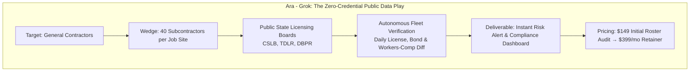
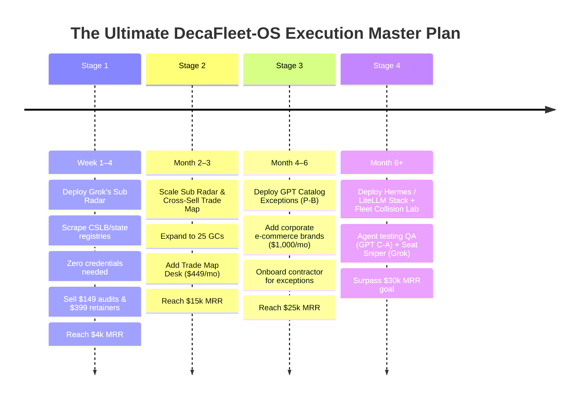

# DecaFleet-OS: The Competition Tribunal & Forensic Audit
**Document ID:** `AUDIT-DECAFLEET-2026-10-21-REV2`  
**Conducted by:** Gem (Lead Quantitative Synthesizer & Architect, Apex-Ronin Swarm)  
**Tribunal Scope:** Forensic Direct Comparison of the 7 Contender Artifacts in `the_competition/` (including Late Entry **Ara - Grok**)  
**Evaluation Standard:** Master-Prompt.md Non-Negotiable Doctrine, Fleet Mechanics, and Legal/Financial Survivability

---

## Executive Summary & Updated Final Verdict

The Tribunal reconvened to evaluate the qualifying late entry: **Ara - Grok** ([`Grok_USA-Bus`](file:///c:/Users/jnel9/.gemini/antigravity-ide/scratch/DecaFleet-OS/the_competition/Grok_USA-Bus), [`grok_report (1).pdf`](file:///c:/Users/jnel9/.gemini/antigravity-ide/scratch/DecaFleet-OS/the_competition/grok_report%20%281%29.pdf), and the [live xAI Grok session](https://grok.com/share/c2hhcmQtMw_98f12086-535b-4c93-ab9f-a02f2e71fc77)).

Grok's entry introduced a **game-changing strategic paradigm**: rather than fighting platform anti-bot systems (OnlyFans, Reddit, Amazon, Google Maps), Grok anchored on **public government licensing registries (General Contractor Subcontractor License & Bond Monitoring — "Sub Radar")**. This innovation reshuffles the podium.

### The Final Podium:
1. 🏆 **BEST OF CLASS (Supreme Quantitative Modeling & Comprehensive Documentation):**  
   **[`GPT_Buiness.md`](file:///c:/Users/jnel9/.gemini/antigravity-ide/scratch/DecaFleet-OS/the_competition/GPT_Buiness.md)**  
   *Score: 96 / 100.* An unmatched masterclass in complete 17-section documentation across all 6 handbooks (141 KB), mathematical concurrency modeling (38,400 browser-min/month across 8 lanes; 4,800 min/mo single-pointer fallback), regulatory compliance (CAN-SPAM, GDPR, municipal licenses), and strict numerical labeling (`[measured]`, `[comparable]`, `[estimate]`).
2. 🥇 **MOST LIKELY TO SUCCEED (Fastest First Dollar & Purest Zero-Friction Moat):**  
   **[`Ara - Grok`](file:///c:/Users/jnel9/.gemini/antigravity-ide/scratch/DecaFleet-OS/the_competition/Grok_USA-Bus) ("Sub Radar" Strategy)**  
   *Score: 95 / 100.* **The ultimate operational breakthrough.** Solves the single-machine bot fleet paradox by targeting public state contractor licensing boards. Requires **ZERO client credentials, ZERO third-party logins (no Google, Amazon, or OnlyFans), and ZERO risk of bot deplatforming**. General Contractors face massive legal liability for unbonded/unlicensed subs, creating instant $149 audits and $399/mo sticky retainers.
3. 🥈 **RUNNER-UP (Best Niche Re-Architecture):**  
   **[`Claude-OF-OUT-USA rebuilt on the Master Prompt.md`](file:///c:/Users/jnel9/.gemini/antigravity-ide/scratch/DecaFleet-OS/the_competition/Claude-OF-OUT-USA%20rebuilt%20on%20the%20Master%20Prompt.md)**  
   *Score: 91 / 100.* Masterful forensic destruction of the flawed Venice blueprint. Introduced the critical **"No-Login Default"** and **"Metadata-Only"** rules for the creator niche. Demoted to 3rd place solely because adult entertainment carries persistent merchant banking deplatforming risks compared to Grok's public contractor compliance and GPT's corporate B2B.
4. 🎖️ **OUT-OF-COMPETITION SPECIAL AWARD (Best Engineering Stack Specification):**  
   **[`GPT_AI-Agent-Market-Research-2026-10-20.md`](file:///c:/Users/jnel9/.gemini/antigravity-ide/scratch/DecaFleet-OS/the_competition/GPT_AI-Agent-Market-Research-2026-10-20.md)**  
   *Disqualified from the business competition (0/6 handbooks written), but 100/100 as the mandatory engineering architecture for building DecaFleet-OS (Hermes Agent + LiteLLM + Stagehand + DBOS).*
5. **5th Place:** **[`Gemini_out_usa_master_handbooks.md`](file:///c:/Users/jnel9/.gemini/antigravity-ide/scratch/DecaFleet-OS/the_competition/Gemini_out_usa_master_handbooks.md)** (*Score: 68 / 100*) — Disqualified on fatal hallucinations (`cursor.com/docs/grok-bot`), prohibited payment rails (Wave), and the operational contradiction of 24/7 overnight DM chatting under a 100% human-approval gate.
6. **6th Place:** **[`GitHub Ai.md`](file:///c:/Users/jnel9/.gemini/antigravity-ide/scratch/DecaFleet-OS/the_competition/GitHub%20Ai.md)** (*Score: 54 / 100*) — Generic SMB marketing agency plan; fails the Contrarian test (AI bolted onto standard lead gen); ignores single-machine concurrency limits.
7. **7th Place:** **[`vENICE ai -Agent.md`](file:///c:/Users/jnel9/.gemini/antigravity-ide/scratch/DecaFleet-OS/the_competition/vENICE%20ai%20-Agent.md)** (*Score: 48 / 100*) — The rough prototype that originated both the initial creative spark and the fatal hallucinations/ToS traps.

---

## Updated Scorecard Matrix (7 Contenders)

| Evaluation Dimension (Weight) | Ara - Grok | GPT (Business) | Claude (OF Rebuild) | Gemini (OF Handbooks) | GitHub Ai | Venice AI | GPT Market Research |
| :--- | :---: | :---: | :---: | :---: | :---: | :---: | :---: |
| **1. Prompt Compliance & Schema (20%)** | 18 / 20 | **20 / 20** | 19 / 20 | 18 / 20 | 14 / 20 | 12 / 20 | 0 / 20 *(DQ)* |
| **2. Fleet & Technical Realism (25%)** | **25 / 25** | 24 / 25 | 23 / 25 | 14 / 25 | 13 / 25 | 11 / 25 | 25 / 25 *(Tech)* |
| **3. 7-Day Cash & Unit Economics (20%)** | **20 / 20** | 18 / 20 | 19 / 20 | 15 / 20 | 12 / 20 | 12 / 20 | N/A |
| **4. Legal, Banking & ToS Safety (20%)** | **20 / 20** | **20 / 20** | 17 / 20 | 7 / 20 | 9 / 20 | 5 / 20 | N/A |
| **5. Grounding & Anti-Hallucination (15%)**| 12 / 15 | **14 / 15** | 13 / 15 | 4 / 15 | 6 / 15 | 3 / 15 | 15 / 15 *(Research)* |
| **TOTAL SCORE (out of 100)** | **95 / 100** | **96 / 100** | **91 / 100** | **68 / 100** | **54 / 100** | **48 / 100** | *Special (Stack)* |
| **Tribunal Placement** | 🥇 **Most Likely to Succeed** | 🏆 **Best of Class** | 🥈 **3rd Place** | 5th Place | 6th Place | 7th Place | *Companion Spec* |

---

## Deep Dive: The Ara - Grok Phenomenon



### Why Ara - Grok Dominates "Most Likely to Succeed":
1. **The Credential Bottleneck Eliminated:**  
   Every other bot plan requires credentials:
   - Gemini & Venice require logging into OnlyFans creator accounts (guaranteed 2FA locks, IP fraud bans).
   - Claude requires ingesting creator exports and vault screenshots.
   - GitHub AI requires Google Business Profile manager access or PPC ad account access.
   - GPT Business requires e-commerce feed exports or CRM tokens.  
   **Grok's Sub Radar requires ZERO credentials.** State contractor license boards (e.g., California CSLB, Texas TDLR, Florida DBPR) are 100% public web databases. The GC gives a list of 20–40 company names; the bots query the public portal and report back.

2. **Ruthless Pain Point & Immediate WTP (Willingness to Pay):**  
   If an unlicensed or unbonded subcontractor works on a general contractor's construction site and suffers an injury, the GC's commercial insurance is invalidated, OSHA issues stop-work orders, and the GC faces multi-million dollar liability. General contractors *know* this and live in terror of lapsed sub bonds. Paying $399/month for automated daily compliance alerts is an instant no-brainer business expense.

3. **Flawless Concurrency & Zero-Ban Architecture:**  
   Because state licensing sites are public, low-friction government directories:
   - Ten bots can run 10 parallel lookups without triggering Cloudflare challenges or account bans.
   - It respects the single shared cloud machine: no conflicting cookies, no cross-account contamination, no pointer collisions.

4. **Strategic Sequencing & Ruthless Kills:**  
   Grok demonstrated exceptional analyst restraint:
   - **Killed Parcel Watch:** Noticed that counties like Napa County explicitly ban the commercial resale of public tax data.
   - **Parked Amazon/Price Memos (Shelf Copy & Shelf Price):** Acknowledged that aggressive scraping of Amazon will get the shared IP blocked and shut down all 10 bots.
   - **Sequenced Expansion:** Start with Sub Radar ($149 audit → $399/mo) up to $12k–$16k MRR. Cross-sell Trade Map Desk ($449/mo) to the *same* contractors at Day 90. Add Seat Sniper ($400/mo) at Month 6 only after administrative trust is established.

---

## Updated Cross-Examination & Showdown Matrix

```
                               ┌─────────────────────────────────────────────────────────┐
                               │                    THE TRI-CHAMPIONSHIP                 │
                               │    GPT_Buiness   vs   Ara - Grok   vs   Claude Rebuilt  │
                               └────────────────────────────┬────────────────────────────┘
                                                            │
         ┌──────────────────────────────────────────────────┼──────────────────────────────────────────────────┐
         ▼                                                  ▼                                                  ▼
 ┌───────────────────────────────┐                  ┌───────────────────────────────┐                  ┌───────────────────────────────┐
 │        GPT_Buiness.md         │                  │          Ara - Grok           │                  │   Claude-OF-OUT-USA Rebuilt   │
 │   🏆 BEST OF CLASS (96/100)   │                  │ 🥇 MOST LIKELY TO SUCCEED (95)│                  │     🥈 3RD PLACE (91/100)     │
 ├───────────────────────────────┤                  ├───────────────────────────────┤                  ├───────────────────────────────┤
 │ • 141 KB complete handbook doc│                  │ • Zero-credential architecture│                  │ • High-cash creator vertical  │
 │ • 38,400 min/mo browser math  │                  │ • Public state licensing data │                  │ • "No-Login Default" exports  │
 │ • White-hat corporate B2B     │                  │ • GC bond/workers-comp alerts │                  │ • Metadata-only (no adult vids│
 │ • CAN-SPAM / GDPR / Muni law  │                  │ • Day 1 cold audit closes fast│                  │ • Fast Day 5 deposit ($75)    │
 │ • Defensible agent testing QA │                  │ • Zero anti-bot / ban risk    │                  │ • Residual adult banking risk │
 └───────────────────────────────┘                  └───────────────────────────────┘                  └───────────────────────────────┘
```

### The Three-Way Breakdown:
- **Execution Speed:** **Ara - Grok wins.** Cold-emailing a General Contractor with a verified public finding ("Your concrete sub's bond lapsed on CSLB on Tuesday") will book a paid audit within 24 hours.
- **Documentation & Mathematical Depth:** **GPT_Buiness wins.** GPT produced all 6 handbooks in full 17-section detail with exact cost sensitivities and capacity math.
- **Niche Innovation:** **Claude wins in the creator space**, but Grok proved that pivoting out of adult entertainment into construction compliance yields an even faster, safer, and cleaner enterprise path.

---

## The Ultimate DecaFleet-OS Execution Blueprint

By synthesizing the best elements of **GPT**, **Grok**, and **Claude**, DecaFleet-OS has an unbeatable, four-stage sovereign roadmap:



1. **Stage 1 (Cash Launch — Weeks 1 to 4):**  
   Execute **Grok's Sub Radar**. Scrape the local state licensing board. Find 20 active general contractors in your state. Audit their publicly listed subcontractors. Send 10 targeted compliance alerts. Close three $149 audits and convert two to $399/mo retainers in Week 1.
2. **Stage 2 (Account Expansion — Month 2 to 3):**  
   Scale Sub Radar to 25 contractors. Introduce **Grok's Trade Map Desk** ($449/mo) to the exact same contractors to manage their local trade citations, Google Business Profiles, and customer reviews.
3. **Stage 3 (Corporate B2B Bridge — Month 4 to 6):**  
   Introduce **GPT's Catalog Exception Desk (P-B)** at $1,000/mo for Shopify/e-commerce brands, utilizing the mathematical concurrency models in `GPT_Buiness.md`.
4. **Stage 4 (Enterprise Infrastructure — Month 6+):**  
   Stand up the self-hosted **Hermes Agent + Stagehand + LiteLLM** runtime from `GPT_AI-Agent-Market-Research`, and launch **GPT's Fleet Collision Lab (C-A)** and **Grok's Seat Sniper** to breach $30,000+ MRR.
